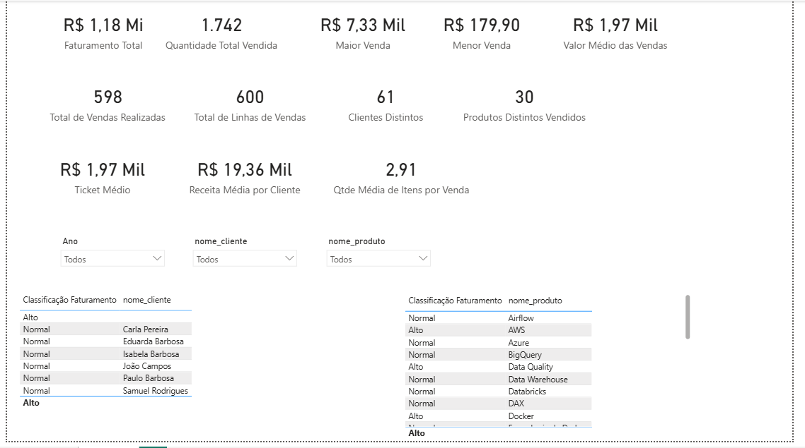

# Desafio DAX - Análise de Vendas

Projeto em Power BI para praticar DAX sobre uma base de vendas, clientes e produtos. O painel tem filtros por ano, cliente e produto.

## Indicadores

| Indicador | Resultado |
| --------- | --------- |
| Faturamento total | R$ 1,18 mi |
| Quantidade total vendida | 1.742 |
| Maior venda | R$ 7,33 mil |
| Menor venda | R$ 179,90 |
| Valor médio das vendas | R$ 1,97 mil |
| Total de vendas realizadas | 598 |
| Total de linhas de vendas | 600 |
| Clientes distintos | 61 |
| Produtos distintos vendidos | 30 |
| Ticket médio | R$ 1,97 mil |
| Receita média por cliente | R$ 19,36 mil |
| Quantidade média de itens por venda | 2,91 |

## Conteúdo do desafio

| Parte | Tema | Funções |
| ----- | ---- | ------- |
| 1 | Agregações | `SUM`, `MAX`, `MIN`, `AVERAGE` |
| 2 | Contagens | `COUNTROWS`, `DISTINCTCOUNT` |
| 3 | Divisão e indicadores | `DIVIDE` |
| 4 | Filtro e contexto | `CALCULATE` |
| 5 | BLANK | `ISBLANK`, `DIVIDE` com valor alternativo |
| 6 | Condicional | `IF`, `VAR` / `RETURN` |

## Modelo de dados

Uma tabela fato (`Vendas`) e três dimensões (`Clientes`, `Produtos` e `dCalendario`).

## Observações

- O painel mostra 600 linhas de venda e 598 vendas, porque algumas vendas têm mais de um item. Por isso uso `COUNTROWS` para linhas e `DISTINCTCOUNT` para vendas.
- As divisões usam `DIVIDE` em vez de `/`, para não gerar erro quando o denominador é zero.
